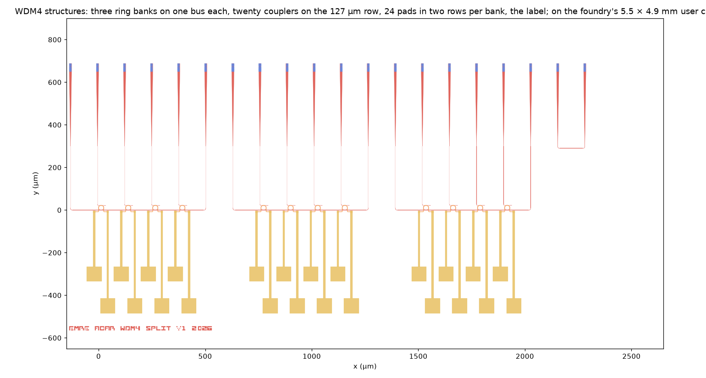

# cornerstone-pic: two photonic test dies on the CORNERSTONE 220 nm silicon platform

Two passive photonic circuits laid out in Python on the open
[cspdk](https://github.com/gdsfactory/cspdk) kit for the CORNERSTONE 220 nm SOI
multi-project wafer run, checked with a KLayout rule deck written from the foundry's
design guidelines, and simulated from each layout's own netlist.

**Nothing here has been fabricated or measured.** All performance figures are predictions.



| Die | What it is | Report | 3D view |
|---|---|---|---|
| WDM4 | Four-channel ring demultiplexer at three coupling gaps, heaters on every ring | [report](https://nanodevo.github.io/reports/wdm4-demux) | [3D](https://nanodevo.github.io/reports/wdm4-3d) |
| MZI4 | Thermo-optic 2x2 switch and three unbalanced interferometers for the group index | [report](https://nanodevo.github.io/reports/mzi-report) | [3D](https://nanodevo.github.io/reports/mzi-3d) |

Both dies sit in one 5.5 x 4.9 mm user cell: `gds/cell0_wdm4_mzi4.gds`, top cell `Cell0_EmreAcar`.

## Predicted results

WDM4, from `step17_predict_split.py`, channel 2:

| Coupling gap | Drop peak | 3 dB width | Neighbour channel |
|---|---|---|---|
| 0.22 um | -0.44 dB | 0.275 nm | -18.2 dB |
| 0.27 um | -0.57 dB | 0.160 nm | -25.5 dB |
| 0.32 um | -0.99 dB | 0.070 nm | -32.8 dB |

MZI4, from `mzi_predict.py`:

- Switch: 1.03 dB insertion loss at rest. Extinction is 43.1 dB at 0.7 % coupler imbalance and 26.0 dB at 5 %.
- Interferometers: FSR 19.335, 9.667 and 4.834 nm for arm differences of 30, 60 and 120 um, which returns a group index of 4.1419.

## Run it

```bash
python3.11 -m venv .venv && .venv/bin/pip install -r requirements.txt
```

Build the layouts:

```bash
.venv/bin/python step16_chip_split.py
.venv/bin/python mzi_die.py
.venv/bin/python cell0_assembly.py
```

Check them against the foundry rules (use absolute paths, and adjust the KLayout path to your system):

```bash
klayout -b -r "$PWD/klayout_tech/drc/cornerstone_220_drc.lydrc" -rd input="$PWD/gds/cell0_wdm4_mzi4.gds" -rd report="$PWD/gds/cell0.lyrdb"
```

Simulate from the netlists:

```bash
.venv/bin/python step17_predict_split.py
.venv/bin/python mzi_predict.py
```

`step15b_coupling.py` and `step18_modes.py` need [femwell](https://github.com/HelgeGehring/femwell) 0.1.12 in a separate environment. Their result is already stored in `data/strip_450x220.json`.

Rebuilding from a clean copy on 05.11.2026 gave layouts geometrically identical to the committed GDS files, with no rule violations on the WDM4 die, the MZI4 die or the assembled cell.

## What is in the repository

| Files | Purpose |
|---|---|
| `step9_ring_add_drop.py`, `step16_3wdm_banks.py`, `step16_chip_split.py` | WDM4: ring cell, bank, die |
| `mzi_die.py` | MZI4 die |
| `cell0_assembly.py` | Both dies in one user cell |
| `klayout_tech/drc/cornerstone_220_drc.lydrc` | Rule deck from the foundry guidelines |
| `klayout_tech/drc/wdm4_drc.lydrc` | Its earlier placeholder version, kept for the record |
| `wdm_models.py`, `mzi_models.py` | Compact models for SAX |
| `step15b_coupling.py`, `step18_modes.py` | Mode solving; coupling against gap |
| `step14_predict.py`, `step17_predict_split.py`, `mzi_predict.py` | Whole-chip simulation from the netlist |
| `export_3d.py`, `export_mzi_3d.py`, `wdm4_figs.py`, `mzi_figs.py` | Data for the 3D pages, and the figures |
| `step2_*` to `step10_*` | The earlier steps of the WDM4 design, in the order they were written |

## Limits

- **Coupler model.** The kit's `coupler_ring` model is marked by its authors as incomplete and not validated by the foundry. It predicted about -16.5 dB drops here, so `wdm_models.py` replaces it with a fit from a femwell supermode calculation. Absolute coupling is still a calculation, which is why the die carries three gaps.
- **Rule deck.** It is written from the guidelines for call #45 (April 2025, Table 2 and section 5.3) and is not the foundry's own check. Read the guidelines of the call you submit to.
- **Assumed values.** Heater power is taken from the foundry's qualification limit of 30 mW per pi, and coupler and bend excess losses from its components library. Fabrication spread is not simulated.

## Sources

- [CORNERSTONE 220 nm SOI design guidelines, call #45](https://www.cornerstone.sotonfab.co.uk/wp-content/uploads/2025/04/CORNERSTONE-45th-Call-Design-Guidelines.pdf)
- [CORNERSTONE SOI standard components library](https://www.cornerstone.sotonfab.co.uk/wp-content/uploads/2023/07/CORNERSTONE-SOI-Standard-Components-Library-Mar-2023.pdf)
- [gdsfactory](https://github.com/gdsfactory/gdsfactory), [cspdk](https://github.com/gdsfactory/cspdk), [SAX](https://github.com/flaport/sax), [femwell](https://github.com/HelgeGehring/femwell), [KLayout](https://www.klayout.de)

## License

MIT. See [LICENSE](LICENSE). This repository does not include the foundry's documents.
